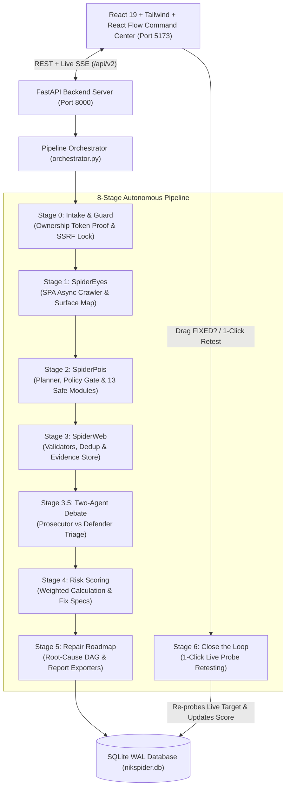

# 🕷️ NikSpider — Autonomous AI AppSec Platform

> **"Scanners give you alerts; NikSpider gives you a triaged, ordered repair plan with a verified retest loop."**

NikSpider is an end-to-end autonomous web application security assessment platform. It replaces noisy, static alert dumps with an **ownership-verified**, **AI-triaged**, **root-cause ordered remediation roadmap** featuring paste-ready coding specifications and an interactive **1-click live retest loop**.

---

## 🚀 Key Highlights & Capabilities

- 🛡️ **Zero-Harm Strict Security Guard (Stage 0)**: Cryptographic domain ownership verification (`/.well-known/nikspider.txt`), anti-SSRF address normalization, RFC 1918 blocking, and DNS rebinding prevention on every outgoing request.
- 👁️ **SpiderEyes Intelligent Discovery (Stage 1)**: SPA-aware crawler combining `httpx` and headless Chromium (Playwright) to extract routes, forms, APIs, and parameter sinks.
- 🎯 **Targeted Planner & 13 Safe Probes (Stage 2)**: Heuristic- and LLM-guided attack surface planning executing 13 safe, non-destructive vulnerability probe modules within strict budget limits.
- ⚖️ **Two-Agent Debate Triage + Judicial Gate (Stage 3 & 3.5)**: Agent A (Exploitability Prosecutor) and Agent B (False-Positive Defender) debate each finding with hard evidence quotes, resolved by a judicial rule engine that deterministically discards escaped reflections and non-session cookies.
- 🗺️ **Root-Cause Remediation Roadmap (Stage 4 & 5)**: Groups related vulnerabilities into dependency-ordered repair nodes visualized as a live React Flow DAG with paste-ready AI assistant prompts (`Claude Code`, `Cursor`).
- 🔄 **1-Click Live Retest Engine (Stage 6)**: Re-executes the exact probe module against the live target to verify the patch, automatically updating the node status to **`FIXED`** and recalculating the risk score.
- 🎮 **Interactive Spider Control Surface UI**: Dark glassmorphic command center with a functional, reactive spider mascot featuring **8 module-probe legs**, **4 severity eyes**, an **anchored Spider AI mini-chat**, **drag-to-retest**, and **live request photon telemetry**.

---

## 🏛️ System Architecture



---

## 📋 Pipeline Stages

| Stage | Name | Description |
| :--- | :--- | :--- |
| **Stage 0** | **Intake & Guard** | Generates ownership challenge token, verifies `/.well-known/nikspider.txt`, and enforces strict SSRF / private IP boundaries. |
| **Stage 1** | **SpiderEyes** | BFS crawler with Playwright DOM extraction, API endpoint scanning, tech fingerprinting, and canary reflection mapping. |
| **Stage 2** | **SpiderPois** | Dynamic attack planner running 13 safe modules within request budgets and circuit-breaker thresholds. |
| **Stage 3** | **SpiderWeb** | SHA-256 fingerprint deduplication, deterministic validator checks, and evidence store indexing. |
| **Stage 3.5**| **Debate Triage** | Structured LLM debate (`severity_case`, `mitigating_factors`, `neutral_summary`) enforced with exact HTTP evidence quotes. |
| **Stage 4** | **Risk Conclusion** | Severity weighting (`Critical: 25`, `High: 15`, `Medium: 7`, `Low: 2`) and AI coding assistant fix specifications. |
| **Stage 5** | **Remediation Roadmap**| Synthesizes root-cause repair nodes, assigns OWASP categories, and generates JSON/Markdown reports. |
| **Stage 6** | **Close the Loop** | Re-executes targeted vulnerability probes on demand to verify remediation and mark issues fixed. |

---

## 🔍 The 13 Non-Destructive Vulnerability Modules

Each check module implements `run()` for discovery and `retest()` for verification:

1. **`sqli` (SQL Injection)**: Syntax error detection and differential boolean tests (`' AND '1'='1` vs `' AND '1'='2`).
2. **`xss` (Cross-Site Scripting)**: Benign canary reflection detection with context-aware HTML entity checks.
3. **`session` (Session & Cookie Security)**: Audits missing `HttpOnly`, `Secure`, and `SameSite` flags on session cookies; ignores benign cosmetic cookies.
4. **`access` (CSRF & Broken Access)**: Detects forms lacking anti-CSRF tokens and tests unauthenticated routes.
5. **`idor` (Insecure Direct Object Reference)**: Tests numeric and UUID parameter manipulation across roles.
6. **`ssrf` (Server-Side Request Forgery)**: Tests webhooks and URL sinks with Out-of-Band (OAST) listener callbacks.
7. **`open_redirect` (Open Redirect)**: Probes redirection parameters against arbitrary external origins.
8. **`cors` (Permissive CORS)**: Detects arbitrary origin reflection paired with credentials allowances.
9. **`headers` & `security_headers`**: Verifies `Content-Security-Policy`, `HSTS`, `X-Content-Type-Options`, and `Referrer-Policy`.
10. **`clickjacking`**: Verifies missing frame-protection headers on sensitive interfaces.
11. **`exposed_files`**: Probes for exposed `.env`, `.git`, debug routes, and database backups.
12. **`cache` (Web Cache Poisoning)**: Tests unkeyed headers (`X-Forwarded-Host`) reflecting in cacheable responses.
13. **`graphql` / `rce`**: Introspects exposed GraphQL endpoints and command-injection vectors safely.

---

## 🕹️ Interactive Spider Control Surface

The dashboard features a live, state-driven moving mascot that acts as an actual control surface:

- **Click-to-Act**:
  - Clicking the spider while idle opens the **Start Scan** modal directly.
  - Clicking the spider mid-scan pauses/resumes the orchestrator between stages or offers immediate scan termination.
- **8 Module-Probe Legs (`L1`–`L8`)**:
  - Each leg maps to a probe module cluster (`SQLi`, `XSS`, `SSRF`, `IDOR`, `Session`, `Headers`, `CORS`, `Surface`).
  - Lights up cyan/violet while actively probing, flashes red upon confirmation, and clicking any leg filters the vulnerability table.
- **4 Glowing Severity Eyes**:
  - Eyes map to `Critical` (red), `High` (amber), `Medium` (violet), and `Low` (blue). Glow intensity and size scale dynamically with live counts. Clicking an eye filters by severity.
- **Spider Head-Tilt ("Looks Toward" Flag)**:
  - The spider's chassis smoothly tilts and rotates toward new findings as they land in the table below.
- **Anchored Spider AI Mini-Chat (Stage 3.5)**:
  - Ask natural-language questions (*"What is my riskiest endpoint?"*, *"What should I fix first?"*) answered with findings context.
- **Drag-to-Retest**:
  - Dragging a **`FIXED?`** badge from the table onto the spider triggers an instant live retest API call.
- **Photon Telemetry Conduit**:
  - Throttled neon pulses travel from the spider to the **Live Telemetry** RPS bar as HTTP requests fire.

---

## 🛠️ Quick Start Guide

### 1. Prerequisites
- **Python 3.10+**
- **Node.js 18+** and **npm**

### 2. Clone the Repository
```bash
git clone https://github.com/Niknicolas226/nikspider.git
cd nikspider
```

### 3. Backend Setup
```bash
# Create and activate virtual environment
python -m venv .venv
# Windows:
.\.venv\Scripts\activate
# Linux/macOS:
source .venv/bin/activate

# Install dependencies
pip install -r requirements.txt

# (Optional) Install Playwright browser for SPA crawling
playwright install chromium
```

### 4. Running the Platform

#### Terminal A: Start the Vulnerable Demo Target (Port 5000)
```powershell
python demo_app/app.py
```

#### Terminal B: Start the FastAPI Backend Server (Port 8000)
```powershell
$env:DEMO_MODE="1"
python -m uvicorn backend.server:app --host 127.0.0.1 --port 8000 --reload
```

#### Terminal C: Start the React Frontend (Port 5173)
```powershell
cd frontend
npm install
npm run dev
```

Open **[http://localhost:5173](http://localhost:5173)** in your browser:
1. Keep the default target `http://localhost:5000`.
2. Click **Verify Ownership** → **Check Verification →** to unlock the Command Center.
3. Click the Spider mascot or **Launch Scan** to start scanning!

---

## 📡 REST API & SSE Endpoints (`/api/v2`)

| Method | Endpoint | Description |
| :--- | :--- | :--- |
| `GET` | `/api/v2/health` | Service health status and `demo_mode` confirmation. |
| `POST` | `/api/v2/targets` | Register target and generate ownership verification token. |
| `POST` | `/api/v2/targets/{id}/verify` | Check `/.well-known/nikspider.txt` token match. |
| `GET` | `/api/v2/targets/{id}/history` | Historical scan sparkline data for target. |
| `POST` | `/api/v2/scans` | Start asynchronous security scan (`safe` / `standard` / `aggressive`). |
| `GET` | `/api/v2/scans/{id}/stream` | Server-Sent Events (SSE) telemetry feed (`crawl_progress`, `plan_ready`, `probe_started`, `raw_flag`, `triage_result`, `roadmap_ready`). |
| `POST` | `/api/v2/scans/{id}/control` | Pause, resume, or abort an active scan. |
| `POST` | `/api/v2/scans/{id}/ask` | Grounded Q&A assistant queries anchored to the spider. |
| `GET` | `/api/v2/scans/{id}/roadmap` | Retrieve the root-cause grouped remediation roadmap. |
| `GET` | `/api/v2/scans/{id}/requests` | Live HTTP request audit log for the scan. |
| `POST` | `/api/v2/findings/{id}/retest` | Re-probe live target to verify remediation; updates risk score. |
| `POST` | `/api/v2/nodes/{id}/prompt` | Generate AI coding assistant fix specifications for a roadmap item. |

---

## 🧪 Testing & Verification

The suite includes **82 automated tests** covering all modules, the intake guard, debate triage, and the retest engine:

```bash
pytest tests/ -v
```

---

## 📄 License

This project is licensed under the Apache License 2.0. See [LICENSE](LICENSE) for details.
