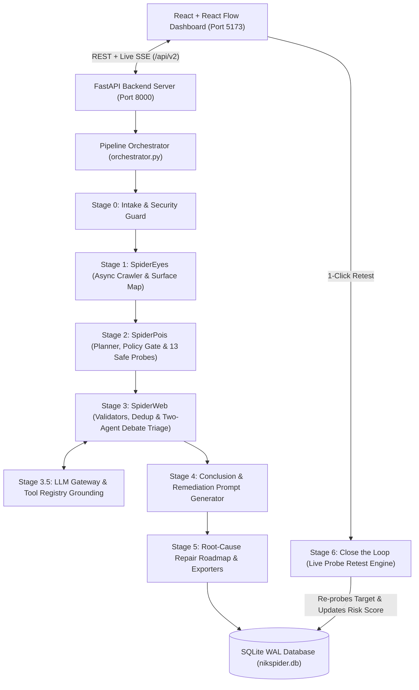

# NikSpider — System Architecture & Functionality Summary

> **One-Line Wedge**: Traditional scanners flood you with raw alerts; **NikSpider** gives you an ownership-verified, AI-triaged, root-cause ordered repair roadmap with paste-ready coding prompts and a 1-click live retest loop.

---

## 1. End-to-End Architecture Overview

NikSpider is organized into an **8-Stage Autonomous Security Assessment Pipeline** backed by SQLite WAL persistence, a FastAPI + Server-Sent Events (SSE) backend, and a React 19 + React Flow interactive dashboard.



---

## 2. Stage-by-Stage Functionality & How It Works

### Stage 0: Intake, Ownership Verification & Security Guard (`nikspider/stage0_intake_guard/`)
Before a single packet is sent to a target, NikSpider enforces strict safety boundaries:
1. **IP & SSRF Guard (`common/http_client.py`, `stage0_intake_guard/guard.py`)**:
   - Normalizes decimal, octal, hex, integer, and IPv4-mapped IPv6 addresses (`normalize_ip`).
   - Blocks all private, loopback, link-local, and cloud metadata IP ranges (`127.0.0.0/8`, `10.0.0.0/8`, `172.16.0.0/12`, `192.168.0.0/16`, `169.254.0.0/16`, `::1/128`, `fc00::/7`, `fe80::/10`).
   - Re-resolves DNS on every outgoing HTTP request via `GuardedClient` to prevent DNS rebinding attacks.
   - Localhost/demo targets (`localhost`, `127.0.0.1`, `demo-app`, `juice-shop`) are only permitted when `DEMO_MODE=1` is explicitly enabled.
2. **Domain Ownership Verification (`stage0_intake_guard/verify.py`)**:
   - Generates a cryptographic token (`nikspider-verify=<token>`).
   - Verifies that the target serves the exact token at `/.well-known/nikspider.txt` before unlocking scan execution.
   - In `DEMO_MODE=1`, the backend automatically syncs the token to `.nikspider-token` so the bundled `demo_app` verifies in one click.
3. **Policy Profiles (`stage0_intake_guard/policy.py`, `config/policy_profiles.yaml`)**:
   - Enforces scan budgets (`max_requests`, `max_pages`, `max_depth`), allowed HTTP methods, rate limits, and allowed modules across three profiles:
     - `safe` (50 requests, depth 1, passive/header modules only)
     - `standard` (500 requests, depth 3, all 13 non-destructive modules)
     - `aggressive` (2000 requests, depth 5, full module suite)

---

### Stage 1: SpiderEyes — Discovery & Attack Surface Mapping (`nikspider/stage1_spidereyes/`)
1. **SPA-Aware Async Crawler (`crawler.py`)**:
   - Performs Breadth-First Search (BFS) crawling scoped strictly to the target origin (`_is_in_scope`).
   - Uses `httpx` + `BeautifulSoup` to extract links, HTML `<form>` actions/methods/inputs, `<script src>` tags, `Set-Cookie` headers, and query parameters.
   - Detects Single-Page Applications (`<div id="root">`, `<app-root>`, `#/` routes) and launches headless **Playwright** Chromium to render the DOM, extract dynamic inputs, and intercept `/api/` and `/rest/` XHR requests.
   - Scans JavaScript/HTML bodies via regex (`API_PATH_PATTERN`) to discover hidden REST endpoints.
2. **Tech Fingerprinting (`fingerprint.py`)**:
   - Identifies web servers, backend frameworks, and frontend libraries from response headers (`Server`, `X-Powered-By`, `X-Generator`), static paths, and HTML body signatures.
3. **Role Provisioning (`roles.py`)**:
   - Provisions an anonymous session (`anon`) by default and supports multi-role authenticated sessions (`userA`, `userB`, `admin`) for differential access control testing.
4. **Canary Surface Mapping (`surface.py`)**:
   - Sends a harmless canary marker (`nsp<hex>`) into discovered parameters to classify where input reflects (`html`, `html_attr`, `js`, `url`, `sql`, or `none`).

---

### Stage 2: SpiderPois — Planning, Policy Gate & Vulnerability Probes (`nikspider/stage2_spiderpois/`)
1. **Test Planner (`planner.py`)**:
   - Maps each crawled URL and parameter sink to the appropriate vulnerability checks (`plan_scans` / `plan_surface_targets`).
   - Uses the LLM when configured or falls back to a deterministic heuristic planner that guarantees baseline site-wide checks plus parameter/form-specific probes.
   - Emits the `plan_ready` SSE event so the frontend renders the **Targeted Test Plan** table in real time.
2. **Policy Gate & Circuit Breaker (`policy_gate.py`)**:
   - Tracks total requests against the profile budget and trips a cooldown circuit breaker if 5 consecutive `5xx` server errors occur.
3. **13 Non-Destructive Vulnerability Modules (`stage2_spiderpois/modules/`)**:
   Every module inherits from the `Probe` / `CheckModule` interface (`run()` + `retest()`):
   - **`sqli.py` (SQL Injection)**: Error-based detection (SQLite, MySQL, PostgreSQL, MSSQL, Oracle syntax error signatures) and boolean-differential (`' AND '1'='1` vs `' AND '1'='2`) verification.
   - **`xss.py` (Cross-Site Scripting)**: Reflected XSS detection using a benign canary (`nsp<tag>"<z>`) checking for unescaped reflection in HTML/JS contexts, plus Playwright DOM XSS detection.
   - **`session.py` (Session & Cookie Security)**: Audits session cookies (`session_id`, `sid`, `jwt`, `auth`, `token`) for missing `HttpOnly`, `Secure`, and `SameSite` flags, while ignoring benign cosmetic cookies (like `theme=dark`). Also detects session tokens leaked in URL query strings.
   - **`access.py` (CSRF & Broken Access Control)**: Detects state-changing POST forms missing anti-CSRF tokens (`csrf_token`, `_token`, `authenticity_token`) and checks unauthenticated access to protected routes (`/admin`, `/internal`, `/api/users`).
   - **`idor.py` (Insecure Direct Object Reference)**: Tests numeric/UUID object references across roles for unauthorized horizontal/vertical data access.
   - **`ssrf.py` (Server-Side Request Forgery)**: Tests URL/webhook/fetch parameters (`url`, `uri`, `target`, `dest`, `callback`) using Out-of-Band Application Security Testing (**OAST**) callbacks (`oracles/inband.py` & `oast_listener/server.py`) and loopback metadata indicators.
   - **`open_redirect.py` (Open Redirect)**: Probes redirect parameters (`next`, `url`, `redirect`, `return`) for unvalidated external `Location` redirects (`https://evil.example.com`).
   - **`cors.py` (CORS Misconfiguration)**: Sends `Origin: https://evil.example.com` to detect arbitrary origin reflection combined with `Access-Control-Allow-Credentials: true` or wildcard `*` origins.
   - **`headers.py` & `security_headers.py`**: Checks for missing `Content-Security-Policy`, `Strict-Transport-Security`, `X-Content-Type-Options`, `Referrer-Policy`, and `Permissions-Policy`.
   - **`clickjacking.py`**: Detects missing `X-Frame-Options` (`DENY`/`SAMEORIGIN`) and CSP `frame-ancestors` directives on framing-sensitive pages.
   - **`exposed_files.py`**: Probes origin once per scan for exposed secrets and debug artifacts (`/.env`, `/.git/HEAD`, `/robots.txt`, `/sitemap.xml`, `/.DS_Store`, `/phpinfo.php`).
   - **`cache.py` (Web Cache Poisoning)**: Tests unkeyed request headers (`X-Forwarded-Host`, `X-Original-URL`) for reflection in cacheable responses.

---

### Stage 3 & 3.5: SpiderWeb — Validation, Deduplication & Debate Triage (`stage3_spiderweb/`, `stage3_5_llm_gateway/`)
1. **Deterministic Validators & Deduplication (`validators/checks.py`, `dedup.py`, `confirm.py`)**:
   - Computes a stable SHA-256 fingerprint (`module | url_template | param`) so repeated findings across pagination or numeric IDs (`/items/1`, `/items/2`) collapse into a single finding.
   - Verifies that every finding has non-empty request/response evidence and a valid signal (`passes_all`).
2. **Two-Agent Debate + Judicial Triage (`triage.py`, `debate_triage.py`)**:
   - **Agent A (Exploitability Prosecutor)**: Argues why the finding is genuinely exploitable based on the HTTP request/response excerpt.
   - **Agent B (False-Positive Defender)**: Argues why the finding might be benign (e.g., HTML entity escaping `&lt;`, parameter reflection without SQL execution, or a non-session cosmetic cookie).
   - **Judge Model + Hard Evidence Enforcement (`enforce()`)**:
     - Resolves the debate into `confirmed`, `rejected`, or `needs_more_evidence`.
     - Enforces deterministic domain rules on top of the LLM output:
       1. Requires `evidence_quote` or a verified signal substring to actually exist in the HTTP response body/headers.
       2. Automatically **rejects** XSS findings where output is HTML-escaped (`&lt;`, `&quot;`, `&#x27;`).
       3. Automatically **rejects** SQLi boolean-differential flags that merely echo the input parameter without a database error.
       4. Forces `session`/cookie findings to map to `A05:2021-Security Misconfiguration`.
   - **Signature Fallback (`triage_static`)**: When running offline or without an LLM key, deterministic signature rules classify severity, OWASP category, and confidence with zero external dependencies.

---

### Stage 4 & 5: Conclusion, Fix Prompts & Root-Cause Repair Roadmap (`stage4_conclusion/`, `stage5_report/`)
1. **Risk Score Synthesizer (`conclusion.py`, `roadmap.py`)**:
   - Aggregates confirmed findings by severity weight (`Critical: 25`, `High: 15`, `Medium: 7/8`, `Low: 2/3`) into a normalized risk score and OWASP Top 10 breakdown.
2. **Root-Cause Roadmap Grouping (`roadmap.py`, `roadmap_fixes.py`)**:
   - Groups individual findings that share an underlying architectural root cause into ordered **Roadmap Nodes** (`RoadmapNode`).
   - Each node contains:
     - `issue`: Human-readable title (e.g., *"SQL Injection via Unparameterized Query"*)
     - `severity` & `owasp`: Prioritized severity badge and OWASP 2021 category
     - `root_cause`: Architectural diagnosis
     - `affects`: List of all vulnerable endpoints covered by this fix
     - `fix_steps`: Ordered engineering remediation steps
     - `code_example`: Concrete secure code implementation
     - `verify`: Verification criterion for retesting
     - `finding_ids`: Linked finding IDs for 1-click retesting
3. **AI Coding Assistant Prompt Bridge (`remediation/research.py`, `config/tool_registry.yaml`)**:
   - Generates a structured, copy-paste specification (`POST /api/v2/nodes/{node_id}/prompt`) grounded in `config/tool_registry.yaml` (and optional LLM refinement) ready to paste into **Claude Code** or **Cursor**.
4. **Report Exporters (`exporters/impl.py`, `report_builder.py`)**:
   - Exports full scan reports in structured **JSON**, **HTML**, **Markdown**, and **PDF** formats.

---

### Stage 6: Close the Loop — 1-Click Live Retest Engine (`stage6_close_the_loop/retest.py`)
1. When a developer patches a vulnerability on the target application and clicks **1-Click Retest** in the UI (`POST /api/v2/findings/{finding_id}/retest`):
   - NikSpider loads the original finding record (URL, parameter, HTTP method, payload type) from SQLite.
   - Instantiates the corresponding probe module and calls `await module.retest(finding, client)` against the live target.
   - If the vulnerability is no longer reproducible (`status == "fixed"`):
     - Marks the finding and its parent `roadmap_nodes` row as `"fixed"` in SQLite.
     - Recomputes the scan's overall `risk_score` from remaining open nodes.
     - Turns the node **Green (`FIXED`)** in the React Flow roadmap tree and updates the KPI summary bar in real time.

---

## 3. Frontend Dashboard & Real-Time SSE Telemetry (`nikspider/frontend/`)

The React frontend (`http://localhost:5173`) communicates with the FastAPI backend (`http://localhost:8000`) through `/api/v2`:

| Component | File | Functionality |
| :--- | :--- | :--- |
| **Target Setup & Verification** | `src/components/TargetScreen.tsx` | Registers target URL (`POST /api/v2/targets`), displays `/.well-known/nikspider.txt` token instructions, verifies domain ownership (`POST /api/v2/targets/:id/verify`), and unlocks scan execution. |
| **Summary KPI Bar** | `src/components/SummaryBar.tsx` | Displays overall Risk Score, Raw Flags count, Confirmed Vulnerabilities, False Positives Filtered, and quick-jump severity pills. |
| **Fix Roadmap Tree** | `src/components/RoadmapTree.tsx` & `CustomRoadmapNode.tsx` | Interactive **React Flow** DAG visualizing root-cause repair nodes ordered by severity (`Critical` → `High` → `Medium` → `Low`) with live `OPEN` / `FIXED` status badges. |
| **Remediation & Retest Drawer** | `src/components/RoadmapDrawer.tsx` | Slide-over drawer for any clicked roadmap node showing root cause, affected URLs, step-by-step fix guide, copyable code snippet, **Generate Fix Prompt** button, and **1-Click Retest** button. |
| **Evidence Triage Panel** | `src/components/DebatePanel.tsx` & `HighlightEvidence.tsx` | Filterable view (`All`, `Confirmed`, `Rejected`) showing validation rationale, confidence score, OWASP tag, raw HTTP request, and syntax-highlighted response excerpts (`HighlightEvidence`). |
| **Live Scan & Planner Feed** | `src/components/LiveScanFeed.tsx` | Real-time SSE telemetry showing pages crawled, queue depth, the **Targeted Test Plan** table (`plan_ready`), live raw flags (`raw_flag`), and the collapsible **Live HTTP Request Log** (`GET /api/v2/scans/:id/requests`). |

### Server-Sent Events (SSE) Protocol (`GET /api/v2/scans/{scan_id}/stream`)
During an active scan, `Orchestrator.stream_progress` streams JSON events consumed by `subscribeScanSSE` in `src/api/client.ts`:
- `{"type": "crawl_progress", "pages": <int>, "queue": <int>}`
- `{"type": "plan_ready", "plan": [{"url": "...", "checks": [...], "why": "..."}]}`
- `{"type": "raw_flag", "id": "...", "module": "...", "url": "..."}`
- `{"type": "triage_result", "id": "...", "verdict": "confirmed|rejected", "severity": "...", "owasp": "...", "confidence": 0.95, "reason": "...", "evidence": {...}}`
- `{"type": "roadmap_ready", "nodes": <int>, "score": <int>}`

---

## 4. API Endpoints Reference (`/api/v2`)

| Method | Endpoint | Description |
| :--- | :--- | :--- |
| `POST` | `/api/v2/targets` | Register a target URL and generate an ownership verification token (writes `.nikspider-token` in `DEMO_MODE=1`). |
| `POST` | `/api/v2/targets/{target_id}/verify` | Fetch `{target_url}/.well-known/nikspider.txt` and verify token match. |
| `POST` | `/api/v2/scans` | Start an asynchronous full-pipeline security scan (`Stages 0–5`). |
| `GET` | `/api/v2/scans/{scan_id}/stream` | Live Server-Sent Events (SSE) stream of crawl, plan, raw flags, triage, and roadmap completion. |
| `GET` | `/api/v2/scans/{scan_id}/roadmap` | Retrieve the root-cause grouped repair roadmap nodes, risk score, and verdict counts from SQLite. |
| `GET` | `/api/v2/scans/{scan_id}/requests` | Retrieve the live outgoing HTTP request audit log (`request_log` table) for a scan. |
| `POST` | `/api/v2/findings/{finding_id}/retest` | Re-run a single vulnerability probe against the target; marks node `fixed` and recomputes risk score on pass. |
| `POST` | `/api/v2/nodes/{node_id}/prompt` | Generate a paste-ready AI coding assistant remediation specification for a roadmap node. |

---

## 5. Verification & Test Suite Status

All **82 automated tests** across 10 test modules pass (`pytest tests/ -v`), covering:
- **`test_guard.py` & `test_verify.py`**: SSRF/private-IP blocking, IP normalization, `DEMO_MODE` allowlisting, and `/.well-known/nikspider.txt` verification.
- **`test_phase1.py`**: Foundation checks for guard, token verification, LLM mock fallback, and crawler HTML/API extraction.
- **`test_modules_demo.py` & `test_modules_retest.py`**: SQLi, XSS, Session, Access Control, and Planner unit & live demo tests across `FIXED=0` (vulnerable) and `FIXED=1` (patched) states.
- **`test_oast_ssrf.py`**: Out-of-band SSRF callback listener (`oast_listener`) detection and retest verification.
- **`test_triage.py` & `test_llm_mock.py`**: Two-agent debate triage, Judge hard evidence enforcement (rejecting HTML-escaped XSS decoys `/search_safe` and benign cookies `/settings`), and offline mock fallbacks.
- **`test_roadmap.py`**: Deterministic and LLM root-cause node grouping, OWASP mapping, finding ID inference, and risk score calculation.
- **`test_staged_pipeline.py`**: Full end-to-end staged pipeline (`Orchestrator` Stages 0–5 and `SpiderAttack` CLI Stages 0–3) verified against `golden_corpus/expected_findings/demo_app.json` plus live retest roundtrip.

---

## 6. Running the Stack Locally

```powershell
# 1. Start the Vulnerable Demo Target (Port 5000)
python demo_app/app.py

# 2. Start the FastAPI Backend Server (Port 8000)
$env:DEMO_MODE="1"
.\.venv\Scripts\python.exe -m uvicorn nikspider.backend.server:app --host 127.0.0.1 --port 8000

# 3. Start the React Frontend Dev Server (Port 5173)
cd nikspider/frontend
npm run dev -- --host 0.0.0.0 --port 5173
```

